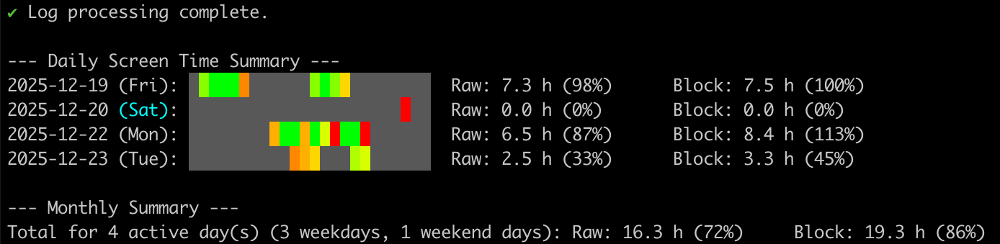

# Time Buddy

A simple to use time tracking CLI for **macOS**.

Track your screen time based on macOS system logs to calculate how many hours you've worked each day.



## Features

- 📊 Track screen time based on macOS unlock/lock events
- 📅 Calculate time spent per day with hourly breakdown visualization
- 📈 Compare periods with trend analysis (week-over-week, etc.)
- 💾 Smart caching for faster subsequent runs
- 🎨 Colorful terminal output with progress indicators
- 📤 Export data to CSV or JSON for integration with other tools
- 📄 Export data as PDF for easy sharing
- 🕒 Background collector (launchd) so history is kept even if you don't run it daily
- 💤 Sessions end on sleep and display-off, not just screen lock

## Requirements

- macOS (uses macOS system logs)
- Python 3.7+ (for development)

## Setup (Required)

Before using Time Buddy, you must enable persistent logging for screen lock/unlock events:

```bash
sudo log config --subsystem com.apple.loginwindow --mode "persist:info"
```

This command configures macOS to persistently store login window events. Without this, the system may not retain the screen lock/unlock logs needed for accurate time tracking.

> **Note**: You only need to run this once. The setting persists across reboots.

## Installation

### pip (Recommended)

```bash
pip install time-buddy
```

### Standalone Binary

If you don't have Python installed:

```bash
curl -fsSL https://raw.githubusercontent.com/alen-z/time-buddy/main/install.sh | bash
```

Or build from source:

```bash
git clone https://github.com/alen-z/time-buddy.git
cd time-buddy
make install
make install-binary
```

## Usage

```bash
# Show version
time-buddy --version

# Show screen time for the last 7 days (default)
time-buddy

# Show screen time for the last 30 days
time-buddy --days 30

# Show detailed session information
time-buddy --verbose

# Force refresh (ignore cache)
time-buddy --no-cache

# Include weekends in expected hours calculation
time-buddy --include-weekends

# Clear the cache
time-buddy --clear-cache

# Export data as JSON
time-buddy --days 30 --export json

# Export data as CSV
time-buddy --days 30 --export csv > december.csv

# Export data as PDF
time-buddy --days 30 --export pdf > december-report.pdf

# View 7 days from a month ago
time-buddy --days 7 --offset 30

# Compare with previous consecutive period (default: no gap)
time-buddy --days 7 --compare-offset

# Compare with a week gap (e.g., this week vs 2 weeks ago)
time-buddy --days 7 --compare-offset 7
```

## Background Collection

macOS only keeps its logs for a limited time. Install the launchd agent to collect events continuously:

```bash
time-buddy daemon install               # twice a day + at login
time-buddy daemon install --interval 60       # interval in minutes
time-buddy daemon status
time-buddy daemon uninstall             # keeps collected data
```

The agent runs `time-buddy collect` at low priority and logs to `~/Library/Logs/TimeBuddy/collect.log`.
If you move or reinstall Time Buddy (or upgrade Python for a pip install), run `daemon install` again.

## Development

```bash
# Install dependencies
make install

# Install locally for testing (editable mode)
pip install -e .

# Run the application
make run

# Create standalone binary
make create-binary

# Test the binary
make test-binary

# Clean build artifacts
make clean
```

## How It Works

Time Buddy reads macOS system logs for screen lock/unlock, system sleep/wake and display on/off events. A session is active while the screen is unlocked, the display is on and the system is awake. It calculates:

- **Raw time**: Actual screen-on time between unlock and lock events
- **Block time**: Sum of time spans for each continuous work session (gaps >1 hour create separate blocks)

The output shows a 24-hour visualization where each block represents an hour, colored by activity intensity.

## License

MIT License
